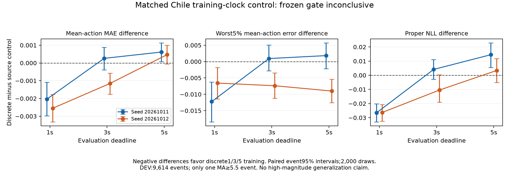

# Completed matched Chile clock experiment

**Result: inconclusive under the frozen bulk gate; no high-magnitude improvement or novel method established.** Four fixed final-epoch-six continuations completed with a normal worker/supervisor exit. The independent saved-result replay passes every artifact, checkpoint, parameter-score, bootstrap, recorded-pairing and gate check. Chile TEST remains sealed.

This known-method control changes only training cutoff sampling: source-uniform versus discrete 1/3/5 seconds. Both seeds start from the same calibration-selected epoch97, retain the fixed TRAIN partition, fresh paired Adam at9e-6, six epochs and five-Gaussian objective. No checkpoint selection, retuning or refit follows these results.

| DEV mean-action MAE | Source, seed11 | Discrete, seed11 | Source, seed12 | Discrete, seed12 |
|---|---:|---:|---:|---:|
| 1 seconds | 0.16127581 | 0.15924265 | 0.16212484 | 0.15957428 |
| 3 seconds | 0.10532144 | 0.10558155 | 0.10599644 | 0.10484099 |
| 5 seconds | 0.08299501 | 0.08360972 | 0.08337594 | 0.08384544 |

Discrete-minus-source differences below use identical retained events. Negative MAE/error/proper-score differences indicate improvement.

| DEV measure | Seed11 | Seed12 |
|---|---:|---:|
| Equal-deadline mean MAE | -0.00038612 | -0.00107883 |
| 1s mean-action mae | -0.00203317 | -0.00255056 |
| 1s mean-action medae | +0.00052767 | -0.00261626 |
| 1s mean-action cvar95 | -0.01223131 | -0.00657265 |
| 1s mean-action p95 | -0.01335520 | -0.00895904 |
| 1s mean-action maximum | -0.03510597 | -0.07777528 |
| 3s mean-action mae | +0.00026011 | -0.00115546 |
| 3s mean-action medae | -0.00028837 | -0.00029269 |
| 3s mean-action cvar95 | +0.00092891 | -0.00738491 |
| 3s mean-action p95 | +0.00161311 | -0.00584613 |
| 3s mean-action maximum | -0.00093207 | -0.00437386 |
| 5s mean-action mae | +0.00061471 | +0.00046951 |
| 5s mean-action medae | +0.00130482 | +0.00197284 |
| 5s mean-action cvar95 | +0.00182967 | -0.00900554 |
| 5s mean-action p95 | +0.00211420 | -0.00322466 |
| 5s mean-action maximum | -0.01837254 | -0.02075036 |
| 1s nll | -0.02658090 | -0.02630456 |
| 1s crps | -0.00295493 | -0.00231558 |
| 3s nll | +0.00413565 | -0.01046382 |
| 3s crps | -0.00013676 | -0.00112140 |
| 5s nll | +0.01453619 | +0.00336988 |
| 5s crps | +0.00032054 | -0.00023420 |

| Cohort / seed | Events | Equal-deadline mean MAE difference | Paired95% interval |
|---|---:|---:|---|
| calibration / 20261011 | 5767 | +0.00174867 | [+0.00098679, +0.00248059] |
| calibration / 20261012 | 5767 | -0.00003856 | [-0.00066685, +0.00055506] |
| dev / 20261011 | 9614 | -0.00038612 | [-0.00091126, +0.00012264] |
| dev / 20261012 | 9614 | -0.00107883 | [-0.00154051, -0.00062143] |

Both seeds pass the prospectively fixed mean-action point criteria: each deadline MAE and MedAE difference is at most+.002, and equal-deadline mean MAE improves. Seed11’s paired confidence interval crosses zero, so the frozen gate is **inconclusive**. No averaging across seeds changes this decision. The paired event bootstrap uses2,000 draws, reset seed20261013, and identical draws across arms/actions/deadlines. Event resampling does not establish earthquake-sequence independence.

One-second mean MAE improves by.00203/.00255. Five-second mean MAE worsens by.000615/.000470 in the two seeds. Seed11 CVaR95/P95 also worsen at3/5 seconds; seed12 improves these worst-error measures. Proper NLL worsens at5 seconds in both seeds and at3 seconds in seed11. These tradeoffs remain visible despite passing the point margins. The aggregate artifact retains both mean/median actions, bias, all deadlines, proper scores, all confidence intervals and undefined-tail bootstrap counts.

Calibration has two MA>=5.5 events and DEV only one, with none MA>=6 in DEV; MA is not Mw. The single DEV high-magnitude mean-error changes at1/3/5 seconds are -.0330/-.0176/-.0695 for seed11 and -.0674/+.1338/+.1504 for seed12. This sparse and inconsistent evidence cannot establish a tail gain. Calibration outcomes are reported separately and never substitute for DEV.

The independent auditor was clean code-only reviewed and passed25 invented tests locally before actual saved-result reads. The exact completed AWS runtime also passes25 tests. An earlier worker fixture invocation ran zero tests because of SSH argument quoting; that setup failure and the corrected invocation are preserved. CPU checkpoint proof verifies5166 saved Adam steps per fit, finite model/optimizer states, final/latest equality and paired persistent non-clock RNG states. No model class, new waveform forward, optimizer step or TEST read occurs in this audit. Recorded trace pairing is checked, rather than regenerated from waveforms.

The completed runtime is Python3.12.10, Torch2.8.0+cu129 and NumPy2.4.6/PCG64. The auditor regenerated producer bootstrap indices in that exact runtime, compared canonical checksums and retained the frozen1e-9 absolute plus1e-9 relative tolerance. The differing local NumPy2.2.6 backend was not silently substituted; no dependency installation or153MB index-array export was needed.

All35 completion/grid artifacts (881,860,378 bytes) and original provenance/state proof are locally preserved against immutable hashes. The dedicated worker had no remaining task/GPU process and a read-only data mount before early graceful shutdown was scheduled for01:59:13 UTC on11October. API shutdown behavior was last authenticated as STOP on10October13:12; final EC2 state verification awaits expired AWS sign-in. No new paid work may start without renewed credit/resource verification. Original and unrelated instances are untouched.

This fixed six-epoch continuation is not a convergence comparison. Original calibration selection and prior DEV inspection remain limitations. No fresh-test generalization, published-benchmark superiority, operational EEW claim or novelty claim follows. No extra paid continuation is earned by this control.

[Complete aggregate independent replay](../../research/2026-10-09/phase2/chile_clock_result_independent_audit/independent_replay_20261011.json) · [Frozen clock protocol](../../research/2026-10-09/phase2/chile_clock_control/protocol.json) · [Independent replay protocol](../../research/2026-10-09/phase2/chile_clock_result_independent_audit/source/PROTOCOL.md)

Independent replay SHA256: `917006ccae8645f5c9031fb1b9b983ef6b01d3653133711b8ace5ec86567631b`. COMPLETE SHA256: `9f78f7744ae0431ddcb12beadabddd92a280508bf62301da398f1beb820b30a6`. Checkpoint proof SHA256: `924efebfca8bb518512bd2e08bdda1d95627c1da2f9496b9cb9d3ca553de280f`.

[Printable figure](figures/chile_clock_control_differences.pdf)
