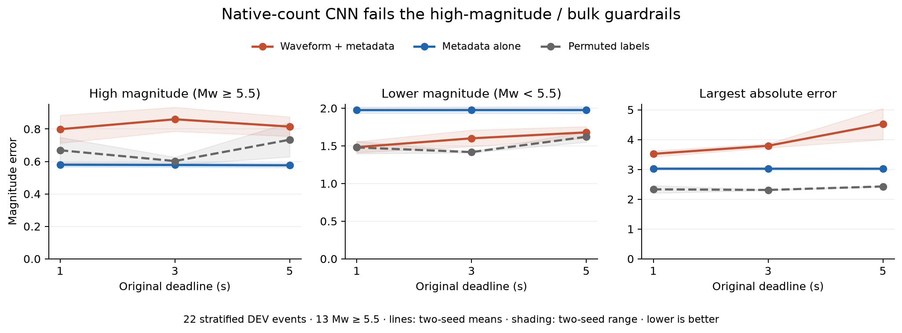

# Completed native-count information pilot: negative

The six fixed CPU fits completed normally and **failed the prospective information gate**. Waveform-plus-metadata W worsens high-Mw MAE relative to metadata-only M at every1/3/5-second deadline in bothseeds. Lower-Mw MAE improves, but worst-error and probability-score checks fail; W does not beat the fixed whole-event label-permutation P control. This result earns no receiver-renewal fit or automatic data expansion. It does not prove waveform information is absent or leakage is present.

The original65selected TRAIN/DEV events retain195coverage placeholders and31TESTexclusions. Native prefix qualification passes independent replay; exact common native tensors yield34TRAIN/22DEV, with26/13Mw>=5.5,24/11Mw>=6,8/9lower. The high-MwDEV cases occupy8operational30day/200km groups. TRAIN/dev label composition differs, so capacity, shift, confounding and model misspecification remain plausible. This deliberately stratified sample is not a natural-population bulk estimate; operational groups are not proven physical sequence independence.

W/M/P share the reviewed convolution/5Gaussian architecture, initialization and event batches within seed. M masks waveform/amplitude; P permutes whole-TRAINevent labels with fixedseed7919. Every event contributes allthree deadlines equally;300Adam updates, two seeds20261012/13, final checkpoint only, noDEV tuning/calibration/stopping, no rare weighting, no failed-fit replacement. Primary action is density mean; median error is secondary. Means uncapped, sigma floor.05. Original catalogue clocks and literal ENZ/1-2-Z families remain; counts and sensitivity metadata are not full response calibration.

Two-seed descriptive averages below; the actual gate uses eachseed separately. High meansMw>=5.5; lower meansMw<5.5.

| Deadline | High-Mw MAE W / M | Lower-Mw MAE W / M | Overall MAE W / M |
|---|---:|---:|---:|
| 1s | 0.7988 / 0.5797 | 1.4835 / 1.9754 | 1.0789 / 1.1507 |
| 3s | 0.8601 / 0.5785 | 1.6005 / 1.9760 | 1.1630 / 1.1502 |
| 5s | 0.8149 / 0.5766 | 1.6795 / 1.9762 | 1.1686 / 1.1491 |

All6fits complete300updates in72.6238seconds on the existing AWS research host. The18private final members include6numeric checkpoints,6durable histories, parameters/predictions and original custody. A separate forward replay reproducesall396pi/mu/sigma predictions exactly. A separately implemented SciPy score path verifies every original DEV target/horizon/rationalrate, NLL/CRPS/mean/median/coverage, event metrics, rate strata, paired group bootstrap and negative advance. It shares NumPy/input custody and its author with the producer; numerical independence is not blinded author independence. All own units stopped; training had2GiB/swap0/64tasks/CPUWeight10/1900second deadline, CUDAhidden/uninitialized. No newinstance/data requests or GPU run.

TRAIN NLL averaged over the final10updates is.6894/.6719 forW,1.1775/1.1859 forM,.8371/.8191 forP. The large TRAIN-to-DEV gap motivates a NEW four-parameter, TRAIN-only amplitude/observation-age likelihood adequacy study with nested operational-group validation. It is an empirical literature-inspired baseline, not novelty or a calibrated displacement reproduction. DEV will not select its parameters. Original neural/activity failures and conditional50-event extension remain unchanged/unearned; new source/tests/review/publication precede any feature/fitting invocation.

The separately completed receiver-activity preflight has34usableTRAINevents and25active-censored groups but only4active-to-quiet groups, below the frozen5floor; no hazard fit. Threshold9/cadence.25/originaldeadlines stayfixed.

Full event-macro metrics, with individual seeds retained:

| Seed | Arm | Time | MAE | MedAE | Mw>=5.5 MAE | Mw>=6 MAE | Lower MAE | NLL | CRPS | CVaR95 | Max |
|---|---|---|---:|---:|---:|---:|---:|---:|---:|---:|---:|
| 20261012 | W | 1s | 1.0577 | 0.8096 | 0.7132 | 0.8084 | 1.5555 | 3.1049 | 0.8406 | 2.8172 | 3.4204 |
| 20261012 | W | 3s | 1.1642 | 1.0114 | 0.7860 | 0.7886 | 1.7106 | 3.8197 | 0.9077 | 3.0288 | 3.7240 |
| 20261012 | W | 5s | 1.1652 | 0.8360 | 0.7552 | 0.7339 | 1.7574 | 3.6094 | 0.9529 | 3.7448 | 5.0447 |
| 20261012 | M | 1s | 1.1748 | 0.9218 | 0.5927 | 0.5665 | 2.0156 | 2.8667 | 0.8973 | 2.8843 | 3.0656 |
| 20261012 | M | 3s | 1.1754 | 0.9231 | 0.5921 | 0.5651 | 2.0180 | 2.8910 | 0.8978 | 2.8855 | 3.0659 |
| 20261012 | M | 5s | 1.1763 | 0.9193 | 0.5907 | 0.5624 | 2.0222 | 2.9122 | 0.8983 | 2.8878 | 3.0668 |
| 20261012 | P | 1s | 1.0816 | 1.1305 | 0.7486 | 0.6571 | 1.5625 | 2.1854 | 0.8267 | 2.4536 | 2.4583 |
| 20261012 | P | 3s | 0.9533 | 0.6667 | 0.6264 | 0.6043 | 1.4255 | 2.5307 | 0.7508 | 2.2777 | 2.3221 |
| 20261012 | P | 5s | 1.1879 | 1.3242 | 0.8395 | 0.8718 | 1.6912 | 3.2042 | 0.9307 | 2.4246 | 2.4400 |
| 20261013 | W | 1s | 1.1001 | 0.8276 | 0.8845 | 0.9560 | 1.4115 | 3.7443 | 0.9091 | 3.0268 | 3.6245 |
| 20261013 | W | 3s | 1.1618 | 0.9325 | 0.9342 | 0.9904 | 1.4905 | 3.7639 | 0.9722 | 3.2013 | 3.8624 |
| 20261013 | W | 5s | 1.1721 | 0.8995 | 0.8747 | 0.9068 | 1.6017 | 4.4065 | 0.9865 | 3.4823 | 4.0017 |
| 20261013 | M | 1s | 1.1266 | 0.8472 | 0.5668 | 0.5483 | 1.9353 | 2.5999 | 0.8703 | 2.8003 | 2.9823 |
| 20261013 | M | 3s | 1.1249 | 0.8456 | 0.5648 | 0.5463 | 1.9339 | 2.5988 | 0.8694 | 2.7988 | 2.9810 |
| 20261013 | M | 5s | 1.1219 | 0.8413 | 0.5624 | 0.5444 | 1.9301 | 2.5897 | 0.8674 | 2.7953 | 2.9779 |
| 20261013 | P | 1s | 0.9197 | 0.7431 | 0.5895 | 0.6295 | 1.3967 | 2.1532 | 0.7026 | 2.1948 | 2.2049 |
| 20261013 | P | 3s | 0.9187 | 0.6351 | 0.5785 | 0.6090 | 1.4102 | 2.1221 | 0.6945 | 2.2424 | 2.2995 |
| 20261013 | P | 5s | 1.0055 | 0.8903 | 0.6284 | 0.6742 | 1.5502 | 2.6076 | 0.7771 | 2.3178 | 2.4163 |

Descriptive group intervals/rate strata are retained in the public aggregate JSON. No novel winner, independent high-Mw generalization, natural bulk preservation or matched published superiority is established. Private waveforms, per-event parameters/labels/clocks and financial receipts remain outsideGit.
