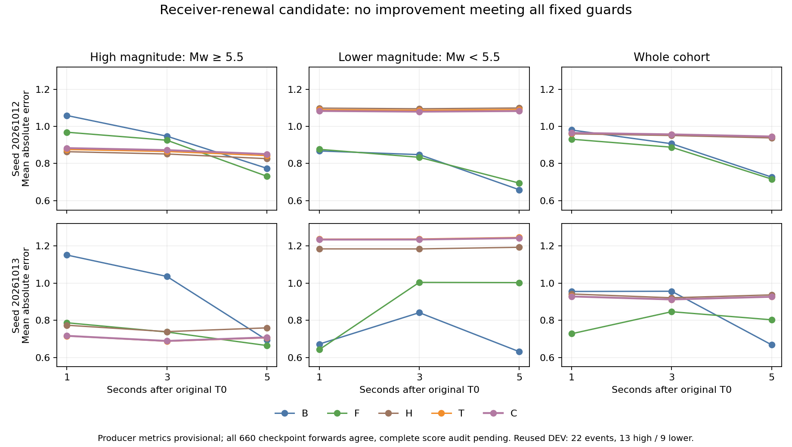

13 October numerical closure: all660forecast scores now independently agree. The unchanged ten-model/two-seed comparison fails all24guards. Earlier provisional tables/figure below describe the same preserved producer forecasts and remain labeled with their historical verification status; the current negative conclusion is independently supported.

# Receiver-renewal comparison at 1, 3 and 5 seconds

The fixed comparison is complete: ten models, two seeds, 300 updates each, and 660 forecasts. The producer reports **zero of 24 predeclared comparisons passed**. All 660 checkpoint forecasts independently reproduce. Complete probability-score replay hit its 900-second deadline and retained no numerical report, so these aggregate values remain provisional. No novel winner or published-benchmark superiority is claimed.

C uses the first native .25-second magnitude distribution and once-only censored activity transitions with run-age resets. B uses current waveform and metadata; F additionally uses continuous activity features; H omits run-age terms; T matches C’s extra curvature using global calendar time. Original B/F/H checkpoints were reused; only seven missing models were trained. Training, numerical tolerances, the common population and success criteria were unchanged.

The table averages the two fixed seeds, with mean magnitude as the primary action. It contains 22 reused exploratory DEV events: 13 Mw>=5.5 and nine below that threshold. Means across seeds do not replace the required separate seed checks.

| Horizon | Arm | High Mw MAE | Lower Mw MAE | Whole MAE | NLL | CRPS |
|---|---|---:|---:|---:|---:|---:|
| 1s | B | 1.1048 | 0.7697 | 0.9677 | 1.5998 | 0.6905 |
| 1s | F | 0.8776 | 0.7592 | 0.8292 | 1.4641 | 0.6009 |
| 1s | H | 0.8185 | 1.1413 | 0.9505 | 1.6543 | 0.6742 |
| 1s | T | 0.7957 | 1.1632 | 0.9460 | 1.6390 | 0.6737 |
| 1s | C | 0.7997 | 1.1586 | 0.9465 | 1.6390 | 0.6736 |
| 3s | B | 0.9915 | 0.8445 | 0.9314 | 1.4806 | 0.6893 |
| 3s | F | 0.8310 | 0.9187 | 0.8669 | 1.4875 | 0.6458 |
| 3s | H | 0.7951 | 1.1394 | 0.9359 | 1.6512 | 0.6710 |
| 3s | T | 0.7760 | 1.1621 | 0.9339 | 1.6367 | 0.6715 |
| 3s | C | 0.7805 | 1.1569 | 0.9345 | 1.6366 | 0.6712 |
| 5s | B | 0.7337 | 0.6448 | 0.6973 | 1.1878 | 0.4815 |
| 5s | F | 0.6976 | 0.8486 | 0.7594 | 1.2967 | 0.5444 |
| 5s | H | 0.7927 | 1.1459 | 0.9372 | 1.6411 | 0.6676 |
| 5s | T | 0.7742 | 1.1682 | 0.9354 | 1.6273 | 0.6685 |
| 5s | C | 0.7792 | 1.1624 | 0.9360 | 1.6272 | 0.6684 |

C has higher high-magnitude MAE than T at every horizon and both seeds. Against B it improves early tail error while increasing lower-magnitude error; at five seconds B and F outperform it on high-magnitude and whole-event error. The run-age reset therefore earns no special contribution in this comparison. The provisional rejection is retained.

The next separately frozen proposal uses all three continuous new-cell powers and carries one shared uncertain pre-earthquake noise reference through successive forecasts. The activity threshold is deterministic from those powers and contributes no second likelihood. Its numerical core is being checked on invented examples; it has no earthquake feature extraction or fit yet. Generic Bayesian updating, Gaussian mixtures, censoring and uncertain-noise inference are established prior art.

TEST remains sealed. This CMT-selected, reused DEV cohort cannot establish natural population bulk preservation, operational timing, response-calibrated physics, global novelty or superiority to published results. A useful method must pass all horizons and both seeds, protect lower and whole MAE/median error plus CVaR/max error, improve proper scores against B/F, and earn independent matched validation.
