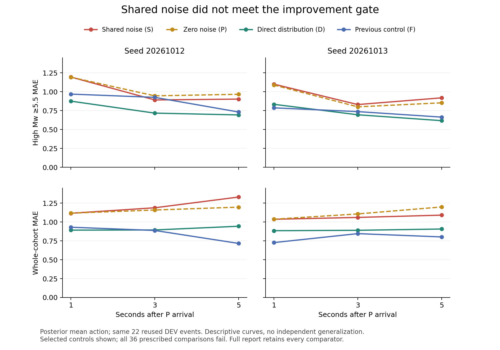

The shared-noise method fails all 36 prescribed improvement checks. The independent audit reproduces all 396 new forecasts, with 528 previously closed comparator forecasts, at 1, 3 and 5 seconds.

D improves high-magnitude and whole-cohort MAE relative to S in both seeds at every horizon. The previous F control remains stronger on bulk error in several cells, so D is not declared a new winner. These curves show four controls for readability; [the full scalar results](earthquake_shared_noise_results.md) retain every comparator and all 36 failed advancement checks.

The cohort contains 22 reused DEV earthquakes. These are exploratory results, not independent generalization or published-benchmark superiority. All original model outcomes, failed admissions and partial attempts are retained. TEST remains sealed.

A separate AR-level L ablation is being prepared using the same original initialization, data, 300-update schedule and criteria. Its 98 scientific-source tests plus 20 reporting tests pass on AWS, with clean Codex reviews. No real L fit has been run; implementation tests provide no magnitude-accuracy evidence.
