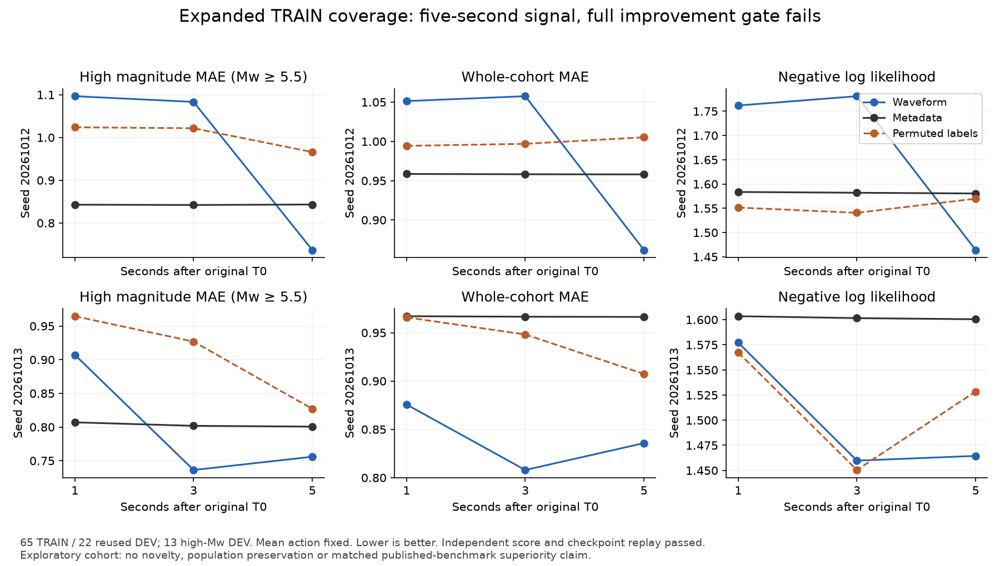

# Expanded TRAIN coverage: useful five-second signal, all-duration gate fails

The fixed50-event extension adds31usable TRAIN events. The combined cohort has65TRAIN (39Mw>=5.5/26lower) and22 unchanged exploratory DEV (13high/9lower). All115/345 outcomes remain, including failures. All original65 groups and metadata remain unchanged; original waveform/numeric bytes are preserved under an explicit array-name mapping. No independent or natural-population evaluation has been added.

Six fixed W/M/P fits complete300updates each in71.903seconds. Independent source-only numerical replay passes; all396 density predictions reproduce exactly from the six final checkpoints, and every context scaler reproduces from TRAIN alone. The complete all1/3/5/bothseed gate fails. W is the full native-count waveform density model, M staticmetadata, P whole-TRAIN-event permuted-label control.

|Seed|Seconds|W highMAE≥5.5|M highMAE≥5.5|W wholeMAE|M wholeMAE|W NLL|M NLL|P NLL|
|---|---:|---:|---:|---:|---:|---:|---:|---:|
|20261012|1|1.0965|0.8428|1.0513|0.9586|1.7618|1.5837|1.5515|
|20261012|3|1.0832|0.8422|1.0575|0.9582|1.7810|1.5820|1.5407|
|20261012|5|0.7369|0.8432|0.8618|0.9580|1.4641|1.5805|1.5698|
|20261013|1|0.9072|0.8070|0.8757|0.9671|1.5772|1.6035|1.5674|
|20261013|3|0.7362|0.8018|0.8079|0.9666|1.4597|1.6016|1.4504|
|20261013|5|0.7559|0.8007|0.8358|0.9664|1.4645|1.6004|1.5286|

At5seconds bothseeds W improves high-tail and wholeMAE versusM and properNLL/CRPS versusbothM/P. At1/3 results differ byseed, withone-seed worsening. No action/seed/horizon selection converts this into the user objective. The result supports limited five-second waveform information while preserving a negative all-duration scientific result.

The unchanged TRAINactivity variation check now passes:9off-transition groups,47active-censored groups and13terminal active ages, versus the original4off failure retained separately. A NEW prospective renewal comparison will test a causal first-.25 prior plus once-only activity likelihood against full-prefix B, ordinary-feature F and run-age-free/time-aware H. Its all-horizon/bothseed tail/proper/bulk/worst requirements remain strict. Source, new native-only causal features, numerical validation, independent replay and actual-run gates still precede that experiment. No C/H fit or novel winner is claimed.

Preserved engineering failures: POST wrapper wrong review-receipt filename before anyrequest; expanded artifact wrapper looked up original two-digit array names in correctly namespaced three-digit output; composite source-test wrappers rejected reserialized-manifest rawsize and then the separately pinned interpreter path. Corrective wrappers retain unchanged processors/science/input selection. All failures remain private read-only.

The owned Chile worker is freshlyconfirmed STOPPED. All own CPU units finish with empty cgroups; original/unrelated workers and disks are preserved. No new GPU/instance was launched. Main eligible-credit expiry31October and absolute2000USD authorized ceiling remain;335USD is a conservative envelope rather than settled spend.

